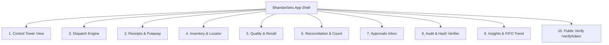

# BhandarSetu (भंडार सेतु) Design System
**Version:** 2.0.0 · **Concept:** "Control Tower, Calm and Civic"

---

## 1. Design Rationale & Metaphor
BhandarSetu is the stock allocation, quality assurance, and traceable dispatch control tower for government PDS (Public Distribution System) godowns supplying Fair Price ration shops.

The design philosophy marries **Linear / Stripe Dashboard precision** with **Indian public-service trust**.
- **No vanity purple or consumer SaaS decoration**: Color is treated strictly as an operational signal.
- **Numbers are the hero**: Quantities, batch numbers, bin coordinates, and cryptographic hashes are rendered with tabular numerals (`font-variant-numeric: tabular-nums`) and monospaced font stacks.
- **Clickable Provenance**: Every number in the UI traces back to its source (ledger event, weighbridge ticket, or laboratory assay).
- **Strict FIFO Clarity**: The user can identify the next-to-dispatch stack in under 5 seconds without ambiguity.

---

## 2. Design Tokens

### 2.1 CSS Variables (Light & Dark)
```css
:root {
  /* Warm-Slate Neutrals */
  --bg-app: #F7F8FA;
  --bg-surface: #FFFFFF;
  --bg-muted: #ECEEF2;
  --border-app: #E4E7EC;
  --text-foreground: #0F172A;
  --text-muted: #64748B;

  /* Civic Brand Accents */
  --brand-saffron: #E8833A;
  --brand-navy: #14213D;

  /* Semantic Status Tokens (Universal meaning across entire app) */
  --status-available: #12A150;      /* Emerald Green */
  --status-near-expiry: #F5A524;    /* Amber Warning */
  --status-quality-hold: #E5484D;   /* Crimson Red */
  --status-quarantine: #991B1B;     /* Deep Red Hatch Pattern */
  --status-reserved: #3B82F6;       /* Indigo / Blue */
  --status-exhausted: #8A94A6;      /* Slate Gray */
  --status-next-dispatch: #059669;  /* Star Badge Hero */
}

.dark {
  --bg-app: #0B0F14;
  --bg-surface: #121821;
  --bg-muted: #1B2330;
  --border-app: #1F2733;
  --text-foreground: #F8FAFC;
  --text-muted: #94A3B8;

  --brand-saffron: #F2934D;
  --brand-navy: #1E293B;
}
```

### 2.2 Typography Hierarchy
- **Primary Interface Font:** `Inter`, -apple-system, sans-serif
- **Data & Batch Identifiers:** `JetBrains Mono`, `ui-monospace`, monospace
- **Devanagari Localization:** `Noto Sans Devanagari`
- **Scale:**
  - `48px` (Hero metric values)
  - `32px` (Section headers)
  - `24px` (Screen headers)
  - `20px` (Card titles)
  - `16px` (Standard emphasis)
  - `14px` (Body text)
  - `12px` (Secondary tables, metadata, chips)
  - `10px` (Micro labels, timestamps, status badges)

---

## 3. Component Inventory

| Component | Path | Description |
| :--- | :--- | :--- |
| `StatusPill` | `components/ui/StatusPill.tsx` | Status pill with icon + label + semantic color (Available, Hold, Recall, Reserved, Next to Dispatch). Never relies on color alone. |
| `AgeBadge` | `components/ui/AgeBadge.tsx` | Age brackets: `<30d` (Fresh green), `31-60d` (Stable teal), `61-90d` (Amber priority), `90+d` (Red urgent dispatch). |
| `QuantityText` | `components/ui/QuantityText.tsx` | Tabular numeral renderer with user preference toggle (`kg` vs `quintal`). Calculates from integer grams. |
| `BatchChip` | `components/ui/BatchChip.tsx` | Monospaced clickable batch token with quick-copy and drawer-trigger behavior. |
| `Header` | `components/ui/Header.tsx` | Universal control tower top rail: Warehouse switcher, live SSE heartbeat, hash chain integrity pill, EN/HI language toggle, Light/Dark toggle, Unit toggle, Role switcher. |
| `Sidebar` | `components/ui/Sidebar.tsx` | Left rail navigation across all 10 screens with real-time pending notification badges. |
| `CommandPalette` | `components/ui/CommandPalette.tsx` | Quick action modal (`Cmd+K` / `Ctrl+K`) for jumping to batches, FPS shops, or triggering dispatches. |
| `DemoControlsDrawer` | `components/ui/DemoControlsDrawer.tsx` | Scenario injector drawer for demoing inward receipts, outward dispatches, quarantine holds, and offline modes. |

---

## 4. Screen Architecture & Sitemap



1. **Control Tower (Home):** 10 High-Density KPI Cards, Live Inbound/Outbound Kanban, 2D Physical Bin Heatmap, Next-to-Dispatch Queue, Outflow Classification, and Live Ledger Ticker.
2. **Dispatch (The Hero Workflow):** 3-step workflow (Destination & Debounced Proportional Multi-Batch Split Bar -> Walk-path Pick Manifest with Scan Verification -> Vehicle Gate Pass & Cryptographic Seal with Maker-Checker exception drawer).
3. **Receipts & Putaway:** Weighbridge gross/tare intake, grain moisture validation, automated batch tagging, AI putaway scoring, and printable QR stack labels.
4. **Inventory & Stack Locator:** Virtualized table, faceted filters (commodity, age, status), and 2D stack locator drawer with shelf-life degradation bar.
5. **Quality & Quarantine:** Laboratory assay registry, 2-man hold & release queue, and Emergency Recall Wizard with downstream ration shop impact trace.
6. **Reconciliation:** Keyboard-first physical stock-taking sheet with live variance calculation, ±0.5% tolerance bounds, and loss audit escalation.
7. **Approvals Inbox:** Unified Maker-Checker dual-signature queue with SLA timers and strict creator self-approval prevention (SQLSTATE `BS004`).
8. **Audit Workspace:** Interactive genealogical batch trace tree and cryptographic hash-chain verifier with simulation of tampering attacks.
9. **Insights:** FIFO dispatch compliance percentage, exception root cause distribution, commodity cover days, and shrinkage analytics.
10. **Public Verify:** Mobile-first unauthenticated verification portal with national civic seal, gate pass confirmation, and SHA-256 ledger attestation.

---

## 5. Accessibility & Performance Standards
- **WCAG AA Compliant:** Contrast ratios exceed 4.5:1 on text and 3:1 on graphical controls.
- **Color Independence:** Every status indicator pairs a distinct icon with text labels; never relies on hue alone.
- **Tabular Alignment:** All numerals use `tabular-nums` to eliminate layout jank during live ticker updates.
- **Keyboard First:** Complete navigation feasible via `Tab`, `Cmd+K`, and `Enter`.

