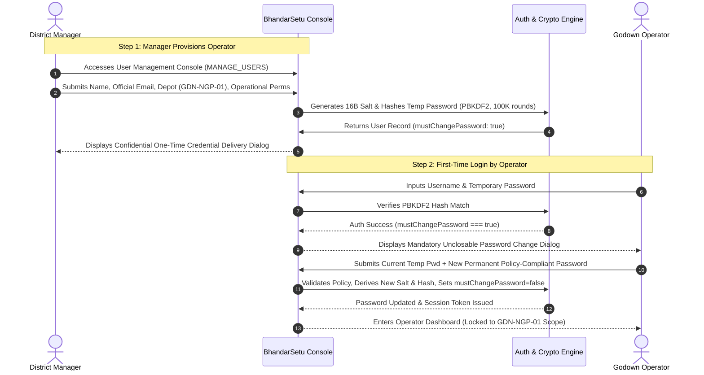

# BhandarSetu — Enterprise Security Architecture & Access Control Specification

> **BhandarSetu: Smart Commodity Inventory & FIFO Management in iPDS**  
> *Ministry of Consumer Affairs, Food & Public Distribution · Government of India*

---

## 1. Executive Summary & Security Principles

BhandarSetu enforces strict security guarantees to protect public grain reserves, prevent pilferage, enforce segregation of duties, and eliminate unauthorized system modifications:

1. **Manager-Created Operator Accounts (No Public Registration)**:
   - Operators **cannot** create accounts, self-register, self-promote, or access Manager-only features.
   - Only verified District Managers can provision, activate, deactivate, or assign granular permissions to Operator accounts.
   - Initial root Manager accounts are created exclusively via an offline, administrative bootstrap script (`bootstrap_manager.py`).

2. **NIST-Compliant Salted Cryptographic Hashing**:
   - Passwords are never stored in plaintext, logged, or displayed in tables.
   - Passwords are salted with 16 bytes of cryptographically secure random entropy (`secrets.token_hex(16)` / `window.crypto.getRandomValues`) and hashed using **PBKDF2-HMAC-SHA256 with 100,000 rounds**.

3. **Confidential One-Time Credential Delivery & Mandatory First Login Change**:
   - Provisioned accounts and reset requests generate secure temporary passwords (or 24-hour invitation tokens) displayed **once** in a modal copy dialog.
   - First-time login enforces an unclosable mandatory password change dialog (`mustChangePassword: true`) requiring an enterprise-grade permanent password before system access is granted.

4. **Depot-Level Multi-Warehouse Data Isolation**:
   - Operators assigned to `GDN-NGP-01` (Nagpur) cannot view, allocate, inward, or dispatch stock belonging to `GDN-PUN-02` (Pune).
   - Cross-warehouse mutations are rejected at both API and frontend boundaries with `HTTP 403 Forbidden`.

5. **Login Abuse Protection & Rate Limiting**:
   - 5 consecutive failed login attempts trigger an automatic 5-minute security lockout.
   - All authentication endpoints return generic error messages to eliminate username harvesting and account enumeration.

6. **Immutable Regulatory Audit Trail**:
   - All authentication, user provisioning, deactivation, and recovery actions are logged with timestamps, actor IDs, server-verified roles, and depot scopes.
   - Audit logs are protected and viewable only by authorized District Managers.

---

## 2. Two-Level Role-Based Access Control (RBAC) Matrix

| Capability / Resource | District Manager / Supervisor (`MANAGER`) | Godown Operator (`WAREHOUSE_ADMIN`) | Quality Assayer (`QUALITY_OFFICER`) |
| :--- | :---: | :---: | :---: |
| **System Scope** | Multi-Depot / National Central Scope | Assigned Depot Scope Only (`GDN-NGP-01` or `GDN-PUN-02`) | Assigned Godown Lab Scope |
| **User Account Provisioning** | ✅ Authorized | ❌ Denied (`HTTP 403`) | ❌ Denied (`HTTP 403`) |
| **Operator Permission Modification**| ✅ Authorized | ❌ Denied (`HTTP 403`) | ❌ Denied (`HTTP 403`) |
| **Account Activation / Suspension** | ✅ Authorized | ❌ Denied (`HTTP 403`) | ❌ Denied (`HTTP 403`) |
| **Regulatory Audit Log Inspection** | ✅ Authorized | ❌ Denied (`HTTP 403`) | ❌ Denied (`HTTP 403`) |
| **System Analytics & Reports** | ✅ Authorized | ❌ Denied (`HTTP 403`) | ❌ Denied (`HTTP 403`) |
| **Quality Release / Override Hold** | ✅ Authorized (Exception Override) | ❌ Denied | ✅ Primary Assayer Authority |
| **Stock Inward / Consignment Intake**| ✅ Authorized | ✅ Scoped to Assigned Depot | ❌ Inspection Only |
| **Batch Inventory Viewing** | ✅ All Depots (or Filtered) | ✅ Scoped to Assigned Depot | ✅ Scoped to Assigned Depot |
| **FIFO Allocation Execution** | ✅ All Depots (or Filtered) | ✅ Scoped to Assigned Depot | ❌ Read-Only |
| **Dispatch Staging & Delivery POD** | ✅ Supervisor Oversight | ✅ Scoped to Assigned Depot | ❌ Read-Only |

---

## 3. Cryptographic Storage & Password Policy

### 3.1 Hash Derivation Algorithm (PBKDF2-HMAC-SHA256)
- **Hash Primitive**: SHA-256
- **Iteration Count**: 100,000 iterations (NIST SP 800-132 recommendation)
- **Salt Generation**: 16 bytes (128 bits) random entropy via CSPRNG
- **Output Length**: 256 bits (64-character hexadecimal digest)
- **Storage Format**: `password_salt` (hex) + `password_hash` (hex) stored in separate columns; plaintext is zeroed from memory immediately after derivation.

### 3.2 Enterprise Password Policy Standard
Passwords configured by users or operators must meet all of the following criteria:
- Minimum length: **8 characters** (12+ recommended)
- At least one uppercase letter (`A-Z`)
- At least one lowercase letter (`a-z`)
- At least one numeric digit (`0-9`)
- At least one special symbol (`!@#$%^&*()_+-=[]{};':"|,.<>/?`)

---

## 4. Account Lifecycle & Provisioning Workflows



---

## 5. Multi-Depot Data Isolation Enforcement

BhandarSetu implements strict tenant-like data isolation per godown:

1. **Read Boundaries**:
   - Operator queries for batches, bins, inward movements, allocation candidates, and dispatch orders automatically filter by `warehouseId === currentUser.warehouseId`.
   - Pune operators (`admin.pune@bhandarsetu.gov.in`) can neither view nor select Nagpur batches (`B001`-`B008`).
   - Nagpur operators (`admin.nagpur@bhandarsetu.gov.in`) can neither view nor select Pune batches (`B009`-`B010`).

2. **Write Boundaries**:
   - Inward consignments submitted by an operator automatically bind `warehouseId = currentUser.warehouseId`.
   - Dispatch requests and FIFO allocations only draw candidate inventory from the operator's assigned depot.
   - Any attempt to access or modify records belonging to another depot triggers an immediate access restriction warning and logs a security event.

---

## 6. Incident Prevention & Rate Limiting

- **Brute-Force Lockout**: 5 failed consecutive attempts for any identifier lock the account for 300 seconds (5 minutes).
- **Session Revocation**:
  - Administrative deactivation of an account immediately terminates active sessions for that user.
  - Resetting an operator's password immediately invalidates all active session tokens.
- **Account Recovery**:
  - Self-service recovery generates a 15-minute, single-use token (`RST-XXXX-XXXX`).
  - Tokens expire automatically and are wiped upon successful completion.

---

## 7. Administrative CLI Bootstrap

For initial system setup in a cold environment without prior accounts, the `bootstrap_manager.py` utility initializes the root Manager account:

```bash
# Provision root manager with secure password prompt
python3 bootstrap_manager.py --username manager@bhandarsetu.gov.in --name "Aayush Tripathi" --email manager@bhandarsetu.gov.in
```

The script derives the 100,000-iteration PBKDF2-HMAC-SHA256 hash using CSPRNG salt and exports credentials to `bootstrap_credentials.json` without hardcoded secrets.
